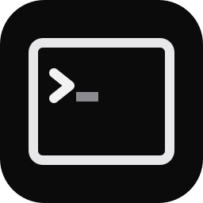

<p align="center">
  
</p>

<h1 align="center">Basalt</h1>

<p align="center">A terminal for running AI coding agents side by side on Windows.</p>

---

Basalt keeps your coding agents (Claude Code, Codex, GitHub Copilot CLI, Gemini, pi
and others) in one window, each in its own terminal, and shows at a glance which one
is working, which one is waiting for you and which one has finished.

## Features

- **Agents at a glance.** Agents are recognized as they start, and their state is
  shown live: working, waiting for you, done or idle.
- **Profiles.** Your own setup by default; any other profile gives every CLI its own
  settings and sign-ins.
- **Sessions.** Split panes and tabs, kept between restarts.
- **Missing commands.** Type a CLI that is not installed and Basalt offers to install
  it, into its own folder.
- **Fast terminal.** GPU-rendered, with history suggestions and search.

## Install

Open PowerShell and run:

```powershell
iwr https://github.com/Utku4836/Basalt/releases/latest/download/basalt.exe -OutFile basalt.exe -UseBasicParsing; .\basalt.exe
```

This downloads `basalt.exe` into the current folder and starts it. You can also
download it from [Releases](https://github.com/Utku4836/Basalt/releases). There is
no installer: the program is complete on its own, font included.

The program is not signed yet, so Windows may say it is from an unknown publisher.
Choose **More info**, then **Run anyway**.

Requires Windows 10 (1809) or later, x64.

## Build

With [Rust](https://rustup.rs) installed:

```
cargo build --release
```

The program is written to `target/release/basalt.exe`.

## License

[MIT](LICENSE). Third-party components and their licenses are listed in
[CREDITS.md](CREDITS.md).

<a href="https://slint.dev"></a>
